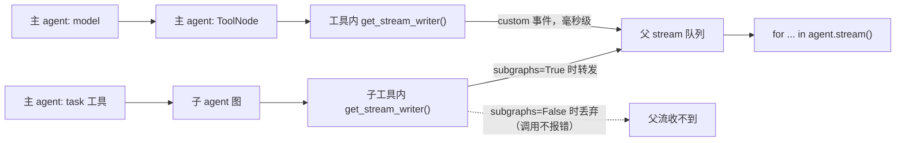

# stream_writer 工具执行期间流式推送实测

- 生成时间：2026-10-23 20:09:22
- 运行命令：`.venv\Scripts\python.exe -m agent.deep_agent.stream_tool`
- 依赖版本：{"langgraph": "1.1.2", "deepagents": "0.4.12", "langchain-core": "1.2.18", "langchain-openai": "1.1.11"}

## 测试设计

工具在 start / progress / end 三个阶段各调用一次 `get_stream_writer()` 推送 custom 事件，阶段之间 `time.sleep(1.0)`，工具总执行时间约 2 秒。
每条 payload 带 `time.perf_counter()` 写入时间戳；消费端记录收到时刻，两者差值即 custom 事件从工具内部写入到消费端拿到的延迟。
判定标准：最大延迟 ≤ 300 ms 视为工具执行期间实时到达；若 start 事件的延迟接近 2 秒，说明事件被缓冲到工具结束后才 flush。

## 核心结论

1. **stream_writer 本身是实时的**：主图工具推送 3 条 custom 事件，消费端延迟 0.1 ms ~ 0.6 ms；首条 start 事件在工具仍在 sleep 时到达，ToolMessage 更新约 2 秒后才出现。
2. **子agent/子图是例外**：`subgraphs=False` 时父流收到 0 条子图 custom 事件；`subgraphs=True` 时收到 3 条，最大延迟 0.5 ms，namespace 形如 `('tools:<task_id>',)`。
3. **只订阅 updates 拿不到 custom**：对照组 custom 条数为 0；custom 与 updates 是两条独立通道，必须把 `"custom"` 显式放进 stream_mode。
4. **同步/异步一致**：`astream` 且 subgraphs=True 时同样收到 3 条，最大延迟 0.8 ms。



## 为什么子图会丢事件

LangGraph 的父 stream 只有在 `subgraphs=True` 时才会挂到子运行的配置上（本机 langgraph 1.1.2，`langgraph/pregel/main.py` 中 `if subgraphs: loop.config[CONF][CONFIG_KEY_STREAM] = loop.stream`）。deepagents 的 `task` 工具在内部通过 `subagent.invoke(...)` 执行子图；父层没有把 stream 接过去时，子图里的 `get_stream_writer()` 调用不会报错，但事件没有进入父 stream 队列，所以消费端永远等不到——这是“根本没到”，不是“晚到”。

开启 `subgraphs=True` 后返回结构也会变：`stream_mode` 是 list 时每块是 `(namespace, mode, chunk)`；`stream_mode` 是单个字符串时是 `(namespace, chunk)`。主图 namespace 为 `()`，子图为 `('tools:<task_id>',)`；只按两元组解析会丢事件或解包报错。

## 总览

| 场景 | 工具位置 | stream_mode | subgraphs | 同步/异步 | custom 条数 | 首条延迟(ms) | 最大延迟(ms) | 首条早于工具结束 | ToolMessage 事件数 | 结论 |
|---|---|---|---|---|---|---|---|---|---|---|
| 场景1：主图工具 + updates/custom + subgraphs=False | 主图 | updates + custom | False | 同步 | 3 | 0.1 | 0.6 | 是 | 1 | 实时收到（工具执行中即到达） |
| 场景2：主图工具 + 只订阅 custom + subgraphs=False | 主图 | custom | False | 同步 | 3 | 0.1 | 0.5 | 是 | 0 | 实时收到（工具执行中即到达） |
| 场景3：子agent工具 + updates/custom + subgraphs=False | 子agent | updates + custom | False | 同步 | 0 | - | - | - | 1 | 未收到 custom（子图事件未转发：subgraphs=False） |
| 场景4：子agent工具 + updates/custom + subgraphs=True | 子agent | updates + custom | True | 同步 | 3 | 0.1 | 0.5 | 是 | 2 | 实时收到（工具执行中即到达） |
| 场景5：子agent工具 + 只订阅 custom + subgraphs=True + astream | 子agent | custom | True | 异步 | 3 | 0.3 | 0.8 | 是 | 0 | 实时收到（工具执行中即到达） |
| 场景6：主图工具 + 只订阅 updates + subgraphs=True（对照组） | 主图 | updates | True | 同步 | 0 | - | - | - | 1 | 对照组：未订阅 custom，收不到是预期 |

## 逐场景结论

- 场景1：主图工具 + updates/custom + subgraphs=False：实时收到（工具执行中即到达）。
- 场景2：主图工具 + 只订阅 custom + subgraphs=False：实时收到（工具执行中即到达）。
- 场景3：子agent工具 + updates/custom + subgraphs=False：未收到 custom（子图事件未转发：subgraphs=False）。
- 场景4：子agent工具 + updates/custom + subgraphs=True：实时收到（工具执行中即到达）。
- 场景5：子agent工具 + 只订阅 custom + subgraphs=True + astream：实时收到（工具执行中即到达）。
- 场景6：主图工具 + 只订阅 updates + subgraphs=True（对照组）：未订阅 custom，收不到是预期（对照组）。

## 拿不到工具流时的排查顺序

1. `stream_mode` 是否包含 `"custom"`——`updates` 不会携带 custom 事件。
2. 工具是否位于子图/subagent 内——如果是，父层是否设置了 `subgraphs=True`。
3. 是否按 `subgraphs=True` 的新返回结构解析（list 模式三元组、单模式二元组）。
4. 工具是否真的在 LangGraph 运行时内执行——直接调用工具函数、把工具丢到图外线程池、或交给图外自定义 agent loop，`get_stream_writer()` 都拿不到父运行的 writer。
5. 上层是否还有自己的转发层（SSE、网关、只转发 `updates` 的中间层）把 custom 过滤掉了。

## 各场景全量事件

## 场景1：主图工具 + updates/custom + subgraphs=False

- 配置：工具位置=主图；stream_mode=updates + custom；subgraphs=False；调用方式=stream
- 总耗时：4939.6 ms
- custom 事件：3 条；首条延迟=0.1 ms；最大延迟=0.6 ms
- 首条 custom 是否在工具结束前到达：是
- 首条 custom 相对开始时刻：867.7 ms；首条 ToolMessage 更新相对开始时刻：2870.2 ms
- 结论：实时收到（工具执行中即到达）

| # | 相对开始(ms) | namespace | mode | custom 延迟(ms) | 摘要 |
|---|---|---|---|---|---|
| 1 | 197.2 | () | updates | - | nodes=[PatchToolCallsMiddleware.before_agent] |
| 2 | 864.9 | () | updates | - | nodes=[model] |
| 3 | 865.8 | () | updates | - | nodes=[TodoListMiddleware.after_model] |
| 4 | 867.7 | () | custom | 0.1 | 主图工具 \| weather_tool_start \| 开始查询 |
| 5 | 1868.2 | () | custom | 0.2 | 主图工具 \| weather_tool_progress \| 正在拉取天气数据 |
| 6 | 2869.1 | () | custom | 0.6 | 主图工具 \| weather_tool_end \| 查询完成 |
| 7 | 2870.2 | () | updates | - | nodes=[tools] \| ToolMessage: 北京的天气是晴天 |
| 8 | 4937.9 | () | updates | - | nodes=[model] |
| 9 | 4938.7 | () | updates | - | nodes=[TodoListMiddleware.after_model] |

原始 payload：

**#1** `updates` namespace=`()` elapsed=`197.2 ms`

```json
{
  "PatchToolCallsMiddleware.before_agent": {
    "messages": {
      "__overwrite__": [
        {
          "content": "查询一下北京的天气",
          "additional_kwargs": {},
          "response_metadata": {},
          "type": "human",
          "name": null,
          "id": "ea14b46f-8532-46fe-9ddc-4355e9dd38bc"
        }
      ]
    }
  }
}
```

**#2** `updates` namespace=`()` elapsed=`864.9 ms`

```json
{
  "model": {
    "messages": [
      {
        "content": "",
        "additional_kwargs": {
          "refusal": null
        },
        "response_metadata": {
          "token_usage": {
            "completion_tokens": 69,
            "prompt_tokens": 6102,
            "total_tokens": 6171,
            "completion_tokens_details": {
              "accepted_prediction_tokens": null,
              "audio_tokens": null,
              "reasoning_tokens": 24,
              "rejected_prediction_tokens": null,
              "text_tokens": 45
            },
            "prompt_tokens_details": null
          },
          "model_provider": "openai",
          "model_name": "deepseek-v4-flash-sz",
          "system_fingerprint": null,
          "id": "d21e8e05d7ec4dc8adb64ac8dd91d87d",
          "finish_reason": "tool_calls",
          "logprobs": null
        },
        "type": "ai",
        "name": null,
        "id": "lc_run--01a168aa-08fb-74f0-a1cb-58f2956a6d40-0",
        "tool_calls": [
          {
            "name": "weather_tool",
            "args": {
              "location": "北京"
            },
            "id": "call_f035cbf596da4eb5b8a32b53",
            "type": "tool_call"
          }
        ],
        "invalid_tool_calls": [],
        "usage_metadata": {
          "input_tokens": 6102,
          "output_tokens": 69,
          "total_tokens": 6171,
          "input_token_details": {},
          "output_token_details": {
            "reasoning": 24
          }
        }
      }
    ]
  }
}
```

**#3** `updates` namespace=`()` elapsed=`865.8 ms`

```json
{
  "TodoListMiddleware.after_model": null
}
```

**#4** `custom` namespace=`()` elapsed=`867.7 ms`

```json
{
  "event": "weather_tool_start",
  "source": "主图工具",
  "location": "北京",
  "detail": "开始查询",
  "ts": 200191.5718407
}
```

**#5** `custom` namespace=`()` elapsed=`1868.2 ms`

```json
{
  "event": "weather_tool_progress",
  "source": "主图工具",
  "location": "北京",
  "detail": "正在拉取天气数据",
  "ts": 200192.5722818
}
```

**#6** `custom` namespace=`()` elapsed=`2869.1 ms`

```json
{
  "event": "weather_tool_end",
  "source": "主图工具",
  "location": "北京",
  "detail": "查询完成",
  "ts": 200193.5727587
}
```

**#7** `updates` namespace=`()` elapsed=`2870.2 ms`

```json
{
  "tools": {
    "messages": [
      {
        "content": "北京的天气是晴天",
        "additional_kwargs": {},
        "response_metadata": {},
        "type": "tool",
        "name": "weather_tool",
        "id": "48a1b45e-1646-4d77-a9c3-baa0f944a2e3",
        "tool_call_id": "call_f035cbf596da4eb5b8a32b53",
        "artifact": null,
        "status": "success"
      }
    ]
  }
}
```

**#8** `updates` namespace=`()` elapsed=`4937.9 ms`

```json
{
  "model": {
    "messages": [
      {
        "content": "北京今天天气是晴天。",
        "additional_kwargs": {
          "refusal": null
        },
        "response_metadata": {
          "token_usage": {
            "completion_tokens": 8,
            "prompt_tokens": 6163,
            "total_tokens": 6171,
            "completion_tokens_details": {
              "accepted_prediction_tokens": null,
              "audio_tokens": null,
              "reasoning_tokens": 1,
              "rejected_prediction_tokens": null,
              "text_tokens": 7
            },
            "prompt_tokens_details": null
          },
          "model_provider": "openai",
          "model_name": "deepseek-v4-flash-sz",
          "system_fingerprint": null,
          "id": "7930b1ca9a454d87853622da037f72d2",
          "finish_reason": "stop",
          "logprobs": null
        },
        "type": "ai",
        "name": null,
        "id": "lc_run--01a168aa-137d-7711-9eb3-27478b62f48a-0",
        "tool_calls": [],
        "invalid_tool_calls": [],
        "usage_metadata": {
          "input_tokens": 6163,
          "output_tokens": 8,
          "total_tokens": 6171,
          "input_token_details": {},
          "output_token_details": {
            "reasoning": 1
          }
        }
      }
    ]
  }
}
```

**#9** `updates` namespace=`()` elapsed=`4938.7 ms`

```json
{
  "TodoListMiddleware.after_model": null
}
```

## 场景2：主图工具 + 只订阅 custom + subgraphs=False

- 配置：工具位置=主图；stream_mode=custom；subgraphs=False；调用方式=stream
- 总耗时：3067.0 ms
- custom 事件：3 条；首条延迟=0.1 ms；最大延迟=0.5 ms
- 首条 custom 是否在工具结束前到达：是
- 首条 custom 相对开始时刻：681.3 ms；首条 ToolMessage 更新相对开始时刻：-
- 结论：实时收到（工具执行中即到达）

| # | 相对开始(ms) | namespace | mode | custom 延迟(ms) | 摘要 |
|---|---|---|---|---|---|
| 1 | 681.3 | () | custom | 0.1 | 主图工具 \| weather_tool_start \| 开始查询 |
| 2 | 1681.7 | () | custom | 0.2 | 主图工具 \| weather_tool_progress \| 正在拉取天气数据 |
| 3 | 2682.5 | () | custom | 0.5 | 主图工具 \| weather_tool_end \| 查询完成 |

原始 payload：

**#1** `custom` namespace=`()` elapsed=`681.3 ms`

```json
{
  "event": "weather_tool_start",
  "source": "主图工具",
  "location": "北京",
  "detail": "开始查询",
  "ts": 200196.3367771
}
```

**#2** `custom` namespace=`()` elapsed=`1681.7 ms`

```json
{
  "event": "weather_tool_progress",
  "source": "主图工具",
  "location": "北京",
  "detail": "正在拉取天气数据",
  "ts": 200197.3372145
}
```

**#3** `custom` namespace=`()` elapsed=`2682.5 ms`

```json
{
  "event": "weather_tool_end",
  "source": "主图工具",
  "location": "北京",
  "detail": "查询完成",
  "ts": 200198.3376846
}
```

## 场景3：子agent工具 + updates/custom + subgraphs=False

- 配置：工具位置=子agent；stream_mode=updates + custom；subgraphs=False；调用方式=stream
- 总耗时：5025.3 ms
- custom 事件：0 条；首条延迟=-；最大延迟=-
- 首条 custom 是否在工具结束前到达：-
- 结论：未收到 custom（子图事件未转发：subgraphs=False）

| # | 相对开始(ms) | namespace | mode | custom 延迟(ms) | 摘要 |
|---|---|---|---|---|---|
| 1 | 1.6 | () | updates | - | nodes=[PatchToolCallsMiddleware.before_agent] |
| 2 | 734.1 | () | updates | - | nodes=[model] |
| 3 | 734.9 | () | updates | - | nodes=[TodoListMiddleware.after_model] |
| 4 | 3681.1 | () | updates | - | nodes=[tools] \| ToolMessage: 北京市今天的天气是**晴天**。🌞 |
| 5 | 5023.0 | () | updates | - | nodes=[model] |
| 6 | 5024.2 | () | updates | - | nodes=[TodoListMiddleware.after_model] |

原始 payload：

**#1** `updates` namespace=`()` elapsed=`1.6 ms`

```json
{
  "PatchToolCallsMiddleware.before_agent": {
    "messages": {
      "__overwrite__": [
        {
          "content": "查询一下北京的天气",
          "additional_kwargs": {},
          "response_metadata": {},
          "type": "human",
          "name": null,
          "id": "69b4065b-0a76-4df7-8769-c740161538d1"
        }
      ]
    }
  }
}
```

**#2** `updates` namespace=`()` elapsed=`734.1 ms`

```json
{
  "model": {
    "messages": [
      {
        "content": "",
        "additional_kwargs": {
          "refusal": null
        },
        "response_metadata": {
          "token_usage": {
            "completion_tokens": 115,
            "prompt_tokens": 6083,
            "total_tokens": 6198,
            "completion_tokens_details": {
              "accepted_prediction_tokens": null,
              "audio_tokens": null,
              "reasoning_tokens": 44,
              "rejected_prediction_tokens": null,
              "text_tokens": 71
            },
            "prompt_tokens_details": null
          },
          "model_provider": "openai",
          "model_name": "deepseek-v4-flash-sz",
          "system_fingerprint": null,
          "id": "0906404218f54d81861e676f1493b967",
          "finish_reason": "tool_calls",
          "logprobs": null
        },
        "type": "ai",
        "name": null,
        "id": "lc_run--01a168aa-2788-74e1-b955-8eff9dcf4f9e-0",
        "tool_calls": [
          {
            "name": "task",
            "args": {
              "description": "查询北京市的天气情况，返回北京的天气信息。",
              "subagent_type": "weather-agent"
            },
            "id": "call_e34cc015fba84aed87f8fdb4",
            "type": "tool_call"
          }
        ],
        "invalid_tool_calls": [],
        "usage_metadata": {
          "input_tokens": 6083,
          "output_tokens": 115,
          "total_tokens": 6198,
          "input_token_details": {},
          "output_token_details": {
            "reasoning": 44
          }
        }
      }
    ]
  }
}
```

**#3** `updates` namespace=`()` elapsed=`734.9 ms`

```json
{
  "TodoListMiddleware.after_model": null
}
```

**#4** `updates` namespace=`()` elapsed=`3681.1 ms`

```json
{
  "tools": {
    "messages": [
      {
        "content": "北京市今天的天气是**晴天**。🌞",
        "additional_kwargs": {},
        "response_metadata": {},
        "type": "tool",
        "name": "task",
        "id": "4e97ffe5-647b-47be-ae83-918627c93181",
        "tool_call_id": "call_e34cc015fba84aed87f8fdb4",
        "artifact": null,
        "status": "success"
      }
    ],
    "files": {}
  }
}
```

**#5** `updates` namespace=`()` elapsed=`5023.0 ms`

```json
{
  "model": {
    "messages": [
      {
        "content": "北京今天的天气是**晴天**。🌞",
        "additional_kwargs": {
          "refusal": null
        },
        "response_metadata": {
          "token_usage": {
            "completion_tokens": 12,
            "prompt_tokens": 6176,
            "total_tokens": 6188,
            "completion_tokens_details": {
              "accepted_prediction_tokens": null,
              "audio_tokens": null,
              "reasoning_tokens": 1,
              "rejected_prediction_tokens": null,
              "text_tokens": 11
            },
            "prompt_tokens_details": null
          },
          "model_provider": "openai",
          "model_name": "deepseek-v4-flash-sz",
          "system_fingerprint": null,
          "id": "a85522c7c14a428abc4e71648115fb1a",
          "finish_reason": "stop",
          "logprobs": null
        },
        "type": "ai",
        "name": null,
        "id": "lc_run--01a168aa-35e9-73f3-983d-afd8a09d0cb8-0",
        "tool_calls": [],
        "invalid_tool_calls": [],
        "usage_metadata": {
          "input_tokens": 6176,
          "output_tokens": 12,
          "total_tokens": 6188,
          "input_token_details": {},
          "output_token_details": {
            "reasoning": 1
          }
        }
      }
    ]
  }
}
```

**#6** `updates` namespace=`()` elapsed=`5024.2 ms`

```json
{
  "TodoListMiddleware.after_model": null
}
```

## 场景4：子agent工具 + updates/custom + subgraphs=True

- 配置：工具位置=子agent；stream_mode=updates + custom；subgraphs=True；调用方式=stream
- 总耗时：4904.8 ms
- custom 事件：3 条；首条延迟=0.1 ms；最大延迟=0.5 ms
- 首条 custom 是否在工具结束前到达：是
- 首条 custom 相对开始时刻：1177.6 ms；首条 ToolMessage 更新相对开始时刻：3180.7 ms
- 结论：实时收到（工具执行中即到达）

| # | 相对开始(ms) | namespace | mode | custom 延迟(ms) | 摘要 |
|---|---|---|---|---|---|
| 1 | 2.0 | () | updates | - | nodes=[PatchToolCallsMiddleware.before_agent] |
| 2 | 642.1 | () | updates | - | nodes=[model] |
| 3 | 643.1 | () | updates | - | nodes=[TodoListMiddleware.after_model] |
| 4 | 647.1 | tools:edc4bda9-8441-ca59-06dc-80c3d638cf57 | updates | - | nodes=[PatchToolCallsMiddleware.before_agent] |
| 5 | 1175.4 | tools:edc4bda9-8441-ca59-06dc-80c3d638cf57 | updates | - | nodes=[model] |
| 6 | 1177.6 | tools:edc4bda9-8441-ca59-06dc-80c3d638cf57 | updates | - | nodes=[TodoListMiddleware.after_model] |
| 7 | 1177.6 | tools:edc4bda9-8441-ca59-06dc-80c3d638cf57 | custom | 0.1 | 子agent工具 \| weather_tool_start \| 开始查询 |
| 8 | 2177.9 | tools:edc4bda9-8441-ca59-06dc-80c3d638cf57 | custom | 0.2 | 子agent工具 \| weather_tool_progress \| 正在拉取天气数据 |
| 9 | 3178.5 | tools:edc4bda9-8441-ca59-06dc-80c3d638cf57 | custom | 0.5 | 子agent工具 \| weather_tool_end \| 查询完成 |
| 10 | 3180.7 | tools:edc4bda9-8441-ca59-06dc-80c3d638cf57 | updates | - | nodes=[tools] \| ToolMessage: 北京市的天气是晴天 |
| 11 | 4375.2 | tools:edc4bda9-8441-ca59-06dc-80c3d638cf57 | updates | - | nodes=[model] |
| 12 | 4375.5 | tools:edc4bda9-8441-ca59-06dc-80c3d638cf57 | updates | - | nodes=[TodoListMiddleware.after_model] |
| 13 | 4376.3 | () | updates | - | nodes=[tools] \| ToolMessage: 根据查询，**北京市**今天的天气情况如下： - **天气状况**：晴天 ☀️ 不过本次查询返回的信息比较简单，仅包含天气状况。如果需要气温、风力、湿度等更详细的天气数据，我这边暂时没有获取到，建议你查看本地天气应用获取更全面的信息。 |
| 14 | 4903.2 | () | updates | - | nodes=[model] |
| 15 | 4904.0 | () | updates | - | nodes=[TodoListMiddleware.after_model] |

原始 payload：

**#1** `updates` namespace=`()` elapsed=`2.0 ms`

```json
{
  "PatchToolCallsMiddleware.before_agent": {
    "messages": {
      "__overwrite__": [
        {
          "content": "查询一下北京的天气",
          "additional_kwargs": {},
          "response_metadata": {},
          "type": "human",
          "name": null,
          "id": "031bef58-dfd7-4430-a132-981949fdf2cc"
        }
      ]
    }
  }
}
```

**#2** `updates` namespace=`()` elapsed=`642.1 ms`

```json
{
  "model": {
    "messages": [
      {
        "content": "",
        "additional_kwargs": {
          "refusal": null
        },
        "response_metadata": {
          "token_usage": {
            "completion_tokens": 115,
            "prompt_tokens": 6083,
            "total_tokens": 6198,
            "completion_tokens_details": {
              "accepted_prediction_tokens": null,
              "audio_tokens": null,
              "reasoning_tokens": 36,
              "rejected_prediction_tokens": null,
              "text_tokens": 79
            },
            "prompt_tokens_details": null
          },
          "model_provider": "openai",
          "model_name": "deepseek-v4-flash-sz",
          "system_fingerprint": null,
          "id": "2e01a6bce21f470d94006e4557e24b67",
          "finish_reason": "tool_calls",
          "logprobs": null
        },
        "type": "ai",
        "name": null,
        "id": "lc_run--01a168aa-3b32-7421-a8ab-ee01abc9e2f3-0",
        "tool_calls": [
          {
            "name": "task",
            "args": {
              "description": "请查询北京市的天气情况，并返回当前的天气状况、气温、风力等详细信息。",
              "subagent_type": "weather-agent"
            },
            "id": "call_3de6d0394fcb423790741a8c",
            "type": "tool_call"
          }
        ],
        "invalid_tool_calls": [],
        "usage_metadata": {
          "input_tokens": 6083,
          "output_tokens": 115,
          "total_tokens": 6198,
          "input_token_details": {},
          "output_token_details": {
            "reasoning": 36
          }
        }
      }
    ]
  }
}
```

**#3** `updates` namespace=`()` elapsed=`643.1 ms`

```json
{
  "TodoListMiddleware.after_model": null
}
```

**#4** `updates` namespace=`('tools:edc4bda9-8441-ca59-06dc-80c3d638cf57',)` elapsed=`647.1 ms`

```json
{
  "PatchToolCallsMiddleware.before_agent": {
    "messages": {
      "__overwrite__": [
        {
          "content": "请查询北京市的天气情况，并返回当前的天气状况、气温、风力等详细信息。",
          "additional_kwargs": {},
          "response_metadata": {},
          "type": "human",
          "name": null,
          "id": "0520be30-9c45-4f99-bdde-dcd9c61663da"
        }
      ]
    }
  }
}
```

**#5** `updates` namespace=`('tools:edc4bda9-8441-ca59-06dc-80c3d638cf57',)` elapsed=`1175.4 ms`

```json
{
  "model": {
    "messages": [
      {
        "content": "",
        "additional_kwargs": {
          "refusal": null
        },
        "response_metadata": {
          "token_usage": {
            "completion_tokens": 88,
            "prompt_tokens": 3527,
            "total_tokens": 3615,
            "completion_tokens_details": {
              "accepted_prediction_tokens": null,
              "audio_tokens": null,
              "reasoning_tokens": 43,
              "rejected_prediction_tokens": null,
              "text_tokens": 45
            },
            "prompt_tokens_details": null
          },
          "model_provider": "openai",
          "model_name": "deepseek-v4-flash-sz",
          "system_fingerprint": null,
          "id": "73a013298ce3490f89af6c6780ba462a",
          "finish_reason": "tool_calls",
          "logprobs": null
        },
        "type": "ai",
        "name": "weather-agent",
        "id": "lc_run--01a168aa-3db2-7a12-aeba-cac524dca747-0",
        "tool_calls": [
          {
            "name": "weather_tool",
            "args": {
              "location": "北京市"
            },
            "id": "call_bf591de7b26a4bbab70bea02",
            "type": "tool_call"
          }
        ],
        "invalid_tool_calls": [],
        "usage_metadata": {
          "input_tokens": 3527,
          "output_tokens": 88,
          "total_tokens": 3615,
          "input_token_details": {},
          "output_token_details": {
            "reasoning": 43
          }
        }
      }
    ]
  }
}
```

**#6** `updates` namespace=`('tools:edc4bda9-8441-ca59-06dc-80c3d638cf57',)` elapsed=`1177.6 ms`

```json
{
  "TodoListMiddleware.after_model": null
}
```

**#7** `custom` namespace=`('tools:edc4bda9-8441-ca59-06dc-80c3d638cf57',)` elapsed=`1177.6 ms`

```json
{
  "event": "weather_tool_start",
  "source": "子agent工具",
  "location": "北京市",
  "detail": "开始查询",
  "ts": 200204.9347874
}
```

**#8** `custom` namespace=`('tools:edc4bda9-8441-ca59-06dc-80c3d638cf57',)` elapsed=`2177.9 ms`

```json
{
  "event": "weather_tool_progress",
  "source": "子agent工具",
  "location": "北京市",
  "detail": "正在拉取天气数据",
  "ts": 200205.9348561
}
```

**#9** `custom` namespace=`('tools:edc4bda9-8441-ca59-06dc-80c3d638cf57',)` elapsed=`3178.5 ms`

```json
{
  "event": "weather_tool_end",
  "source": "子agent工具",
  "location": "北京市",
  "detail": "查询完成",
  "ts": 200206.9352559
}
```

**#10** `updates` namespace=`('tools:edc4bda9-8441-ca59-06dc-80c3d638cf57',)` elapsed=`3180.7 ms`

```json
{
  "tools": {
    "messages": [
      {
        "content": "北京市的天气是晴天",
        "additional_kwargs": {},
        "response_metadata": {},
        "type": "tool",
        "name": "weather_tool",
        "id": "296340dd-303a-43c5-9fa6-ba0cbf8cc2eb",
        "tool_call_id": "call_bf591de7b26a4bbab70bea02",
        "artifact": null,
        "status": "success"
      }
    ]
  }
}
```

**#11** `updates` namespace=`('tools:edc4bda9-8441-ca59-06dc-80c3d638cf57',)` elapsed=`4375.2 ms`

```json
{
  "model": {
    "messages": [
      {
        "content": "根据查询，**北京市**今天的天气情况如下：\n\n- **天气状况**：晴天 ☀️\n\n不过本次查询返回的信息比较简单，仅包含天气状况。如果需要气温、风力、湿度等更详细的天气数据，我这边暂时没有获取到，建议你查看本地天气应用获取更全面的信息。",
        "additional_kwargs": {
          "refusal": null
        },
        "response_metadata": {
          "token_usage": {
            "completion_tokens": 151,
            "prompt_tokens": 3589,
            "total_tokens": 3740,
            "completion_tokens_details": {
              "accepted_prediction_tokens": null,
              "audio_tokens": null,
              "reasoning_tokens": 86,
              "rejected_prediction_tokens": null,
              "text_tokens": 65
            },
            "prompt_tokens_details": null
          },
          "model_provider": "openai",
          "model_name": "deepseek-v4-flash-sz",
          "system_fingerprint": null,
          "id": "be74e8cc12444b9d840a79ecd6c20a65",
          "finish_reason": "stop",
          "logprobs": null
        },
        "type": "ai",
        "name": "weather-agent",
        "id": "lc_run--01a168aa-479d-71f2-9436-36a1c4da8cae-0",
        "tool_calls": [],
        "invalid_tool_calls": [],
        "usage_metadata": {
          "input_tokens": 3589,
          "output_tokens": 151,
          "total_tokens": 3740,
          "input_token_details": {},
          "output_token_details": {
            "reasoning": 86
          }
        }
      }
    ]
  }
}
```

**#12** `updates` namespace=`('tools:edc4bda9-8441-ca59-06dc-80c3d638cf57',)` elapsed=`4375.5 ms`

```json
{
  "TodoListMiddleware.after_model": null
}
```

**#13** `updates` namespace=`()` elapsed=`4376.3 ms`

```json
{
  "tools": {
    "messages": [
      {
        "content": "根据查询，**北京市**今天的天气情况如下：\n\n- **天气状况**：晴天 ☀️\n\n不过本次查询返回的信息比较简单，仅包含天气状况。如果需要气温、风力、湿度等更详细的天气数据，我这边暂时没有获取到，建议你查看本地天气应用获取更全面的信息。",
        "additional_kwargs": {},
        "response_metadata": {},
        "type": "tool",
        "name": "task",
        "id": "0af75487-f252-4d18-9127-35cb41f93528",
        "tool_call_id": "call_3de6d0394fcb423790741a8c",
        "artifact": null,
        "status": "success"
      }
    ],
    "files": {}
  }
}
```

**#14** `updates` namespace=`()` elapsed=`4903.2 ms`

```json
{
  "model": {
    "messages": [
      {
        "content": "北京今天天气为**晴天 ☀️**。\n\n不过这次查询返回的信息比较简单，只包含了天气状况，没有拿到气温、风力等详细数据。如果需要更完整的天气信息，建议通过本地天气应用查看。",
        "additional_kwargs": {
          "refusal": null
        },
        "response_metadata": {
          "token_usage": {
            "completion_tokens": 47,
            "prompt_tokens": 6237,
            "total_tokens": 6284,
            "completion_tokens_details": {
              "accepted_prediction_tokens": null,
              "audio_tokens": null,
              "reasoning_tokens": 1,
              "rejected_prediction_tokens": null,
              "text_tokens": 46
            },
            "prompt_tokens_details": null
          },
          "model_provider": "openai",
          "model_name": "deepseek-v4-flash-sz",
          "system_fingerprint": null,
          "id": "cadf8769290b43b2990b44b91de7693a",
          "finish_reason": "stop",
          "logprobs": null
        },
        "type": "ai",
        "name": null,
        "id": "lc_run--01a168aa-4c48-7452-86eb-828e9f38cc07-0",
        "tool_calls": [],
        "invalid_tool_calls": [],
        "usage_metadata": {
          "input_tokens": 6237,
          "output_tokens": 47,
          "total_tokens": 6284,
          "input_token_details": {},
          "output_token_details": {
            "reasoning": 1
          }
        }
      }
    ]
  }
}
```

**#15** `updates` namespace=`()` elapsed=`4904.0 ms`

```json
{
  "TodoListMiddleware.after_model": null
}
```

## 场景5：子agent工具 + 只订阅 custom + subgraphs=True + astream

- 配置：工具位置=子agent；stream_mode=custom；subgraphs=True；调用方式=astream
- 总耗时：4634.2 ms
- custom 事件：3 条；首条延迟=0.3 ms；最大延迟=0.8 ms
- 首条 custom 是否在工具结束前到达：是
- 首条 custom 相对开始时刻：1414.5 ms；首条 ToolMessage 更新相对开始时刻：-
- 结论：实时收到（工具执行中即到达）

| # | 相对开始(ms) | namespace | mode | custom 延迟(ms) | 摘要 |
|---|---|---|---|---|---|
| 1 | 1414.5 | tools:19735a62-2523-9282-38fd-7b0309de57a3 | custom | 0.3 | 子agent工具 \| weather_tool_start \| 开始查询 |
| 2 | 2415.0 | tools:19735a62-2523-9282-38fd-7b0309de57a3 | custom | 0.3 | 子agent工具 \| weather_tool_progress \| 正在拉取天气数据 |
| 3 | 3416.0 | tools:19735a62-2523-9282-38fd-7b0309de57a3 | custom | 0.8 | 子agent工具 \| weather_tool_end \| 查询完成 |

原始 payload：

**#1** `custom` namespace=`('tools:19735a62-2523-9282-38fd-7b0309de57a3',)` elapsed=`1414.5 ms`

```json
{
  "event": "weather_tool_start",
  "source": "子agent工具",
  "location": "北京市",
  "detail": "开始查询",
  "ts": 200210.0884439
}
```

**#2** `custom` namespace=`('tools:19735a62-2523-9282-38fd-7b0309de57a3',)` elapsed=`2415.0 ms`

```json
{
  "event": "weather_tool_progress",
  "source": "子agent工具",
  "location": "北京市",
  "detail": "正在拉取天气数据",
  "ts": 200211.0889132
}
```

**#3** `custom` namespace=`('tools:19735a62-2523-9282-38fd-7b0309de57a3',)` elapsed=`3416.0 ms`

```json
{
  "event": "weather_tool_end",
  "source": "子agent工具",
  "location": "北京市",
  "detail": "查询完成",
  "ts": 200212.0894978
}
```

## 场景6：主图工具 + 只订阅 updates + subgraphs=True（对照组）

- 配置：工具位置=主图；stream_mode=updates；subgraphs=True；调用方式=stream
- 总耗时：3657.6 ms
- custom 事件：0 条；首条延迟=-；最大延迟=-
- 首条 custom 是否在工具结束前到达：-
- 结论：对照组：未订阅 custom，收不到是预期

| # | 相对开始(ms) | namespace | mode | custom 延迟(ms) | 摘要 |
|---|---|---|---|---|---|
| 1 | 1.4 | () | updates | - | nodes=[PatchToolCallsMiddleware.before_agent] |
| 2 | 1199.4 | () | updates | - | nodes=[model] |
| 3 | 1200.3 | () | updates | - | nodes=[TodoListMiddleware.after_model] |
| 4 | 3204.3 | () | updates | - | nodes=[tools] \| ToolMessage: 北京的天气是晴天 |
| 5 | 3655.1 | () | updates | - | nodes=[model] |
| 6 | 3656.4 | () | updates | - | nodes=[TodoListMiddleware.after_model] |

原始 payload：

**#1** `updates` namespace=`()` elapsed=`1.4 ms`

```json
{
  "PatchToolCallsMiddleware.before_agent": {
    "messages": {
      "__overwrite__": [
        {
          "content": "查询一下北京的天气",
          "additional_kwargs": {},
          "response_metadata": {},
          "type": "human",
          "name": null,
          "id": "9add7a34-1ba9-435a-b823-af2d3dfbab99"
        }
      ]
    }
  }
}
```

**#2** `updates` namespace=`()` elapsed=`1199.4 ms`

```json
{
  "model": {
    "messages": [
      {
        "content": "",
        "additional_kwargs": {
          "refusal": null
        },
        "response_metadata": {
          "token_usage": {
            "completion_tokens": 76,
            "prompt_tokens": 6102,
            "total_tokens": 6178,
            "completion_tokens_details": {
              "accepted_prediction_tokens": null,
              "audio_tokens": null,
              "reasoning_tokens": 31,
              "rejected_prediction_tokens": null,
              "text_tokens": 45
            },
            "prompt_tokens_details": null
          },
          "model_provider": "openai",
          "model_name": "deepseek-v4-flash-sz",
          "system_fingerprint": null,
          "id": "e3c85783fa0b47f98aeed2200ea30ff1",
          "finish_reason": "tool_calls",
          "logprobs": null
        },
        "type": "ai",
        "name": null,
        "id": "lc_run--01a168aa-6086-7330-b88c-d7fb304397aa-0",
        "tool_calls": [
          {
            "name": "weather_tool",
            "args": {
              "location": "北京"
            },
            "id": "call_09a04b4b2ab9463b8c1d23e5",
            "type": "tool_call"
          }
        ],
        "invalid_tool_calls": [],
        "usage_metadata": {
          "input_tokens": 6102,
          "output_tokens": 76,
          "total_tokens": 6178,
          "input_token_details": {},
          "output_token_details": {
            "reasoning": 31
          }
        }
      }
    ]
  }
}
```

**#3** `updates` namespace=`()` elapsed=`1200.3 ms`

```json
{
  "TodoListMiddleware.after_model": null
}
```

**#4** `updates` namespace=`()` elapsed=`3204.3 ms`

```json
{
  "tools": {
    "messages": [
      {
        "content": "北京的天气是晴天",
        "additional_kwargs": {},
        "response_metadata": {},
        "type": "tool",
        "name": "weather_tool",
        "id": "f06cb690-ca6b-4162-8d62-9736706f817c",
        "tool_call_id": "call_09a04b4b2ab9463b8c1d23e5",
        "artifact": null,
        "status": "success"
      }
    ]
  }
}
```

**#5** `updates` namespace=`()` elapsed=`3655.1 ms`

```json
{
  "model": {
    "messages": [
      {
        "content": "北京今天天气晴朗，适合外出活动。",
        "additional_kwargs": {
          "refusal": null
        },
        "response_metadata": {
          "token_usage": {
            "completion_tokens": 11,
            "prompt_tokens": 6163,
            "total_tokens": 6174,
            "completion_tokens_details": {
              "accepted_prediction_tokens": null,
              "audio_tokens": null,
              "reasoning_tokens": 1,
              "rejected_prediction_tokens": null,
              "text_tokens": 10
            },
            "prompt_tokens_details": null
          },
          "model_provider": "openai",
          "model_name": "deepseek-v4-flash-sz",
          "system_fingerprint": null,
          "id": "aefb6c327e144040860025792f2d37f6",
          "finish_reason": "stop",
          "logprobs": null
        },
        "type": "ai",
        "name": null,
        "id": "lc_run--01a168aa-6d09-7cb1-bed5-78743b214e6d-0",
        "tool_calls": [],
        "invalid_tool_calls": [],
        "usage_metadata": {
          "input_tokens": 6163,
          "output_tokens": 11,
          "total_tokens": 6174,
          "input_token_details": {},
          "output_token_details": {
            "reasoning": 1
          }
        }
      }
    ]
  }
}
```

**#6** `updates` namespace=`()` elapsed=`3656.4 ms`

```json
{
  "TodoListMiddleware.after_model": null
}
```
